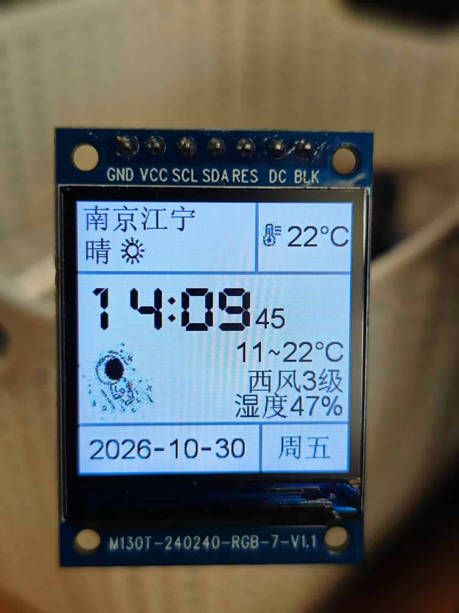

# ESP32C3_Weather_Clock（合宙 CORE-ESP32-C3 经典版 + ST7789）

基于开源项目 Kerrbty/ESP32C3Clock（太空人天气时钟）移植，改为**和风天气 API** 驱动、
可按键循环切换城市。截图如下



## 硬件
- 主控：合宙 CORE-ESP32-C3 经典版（AirM2M_CORE_ESP32C3）
- 屏幕：1.3 寸 240×240 ST7789 IPS **7 针**（无 CS、无 MISO）

## 屏幕接线（屏 → 板）

| 屏幕引脚 | 开发板引脚 | 备注 |
|---------|-----------|------|
| GND     | 任意 GND   |      |
| VCC     | 任意 3V3   |      |
| SCL     | IO02 (脚19) | SPI 时钟 |
| SDA     | IO03 (脚20) | SPI 数据 |
| RES     | IO05 (脚27) | 原 GPIO10 焊盘脱落，改 IO05 |
| DC      | IO04 (脚28) | 原 GPIO06 焊盘脱落，改 IO04 |
| BLK     | IO07 (脚23) | 背光 |

> 屏幕的 CS 直接接 GND（TFT_eSPI 里未定义 TFT_CS）。

## 城市切换按键
默认用**板载 BOOT 键（GPIO9，脚30）**，免接线。按下即循环切换到下一个地点。
如需改用其他引脚，编辑 `user_config.h` 里的 `BUTTON_PIN`（可用 IO00 脚2 / IO01 脚3）。

我添加了 5 个城市（和风天气 LocationID）：

| 城市 | LocationID |
|------|-----------|
| 南京栖霞 | 101190112 |
| 南京江宁 | 101190104 |
| 合肥瑶海 | 101220107 |
| 安庆潜山 | 101220604 |
| 安庆桐城 | 101220609 |

## 如何获取和风天气你的城市的 LocationID

只需简单执行一条 curl 命令

```
curl --compressed -G \
  -H "X-QW-Api-Key: YOUR_API_KEY" \
  --data-urlencode "location=海淀" \
  --data-urlencode "adm=北京" \
  --data-urlencode "range=cn" \
  "https://YOUR_API_HOST/geo/v2/city/lookup"
```

有一点提醒：和风天气控制台现在推荐使用 JSON Web Token 方式认证，官方有如下声明：

> API KEY的认证方式无法提供足够的安全性，因此我们计划从2027年1月1日起，使用API KEY认证方式都将受请求量的限制。
> 我们推荐使用JSON Web Token (JWT)的认证方式获得更高等级的安全性以及不受限的API请求。

本项目就不用 JWT 了，那样在 ESP32-C3 板子上编码稍显复杂，目前 API KEY 形式认证仍能使用，并在2027年或之后只是受到请求量限制，个人使用完全足够。

## 配置 API KEY
1. 执行 `cp secrets.h.example secrets.h`。编辑 `secrets.h`，把 `YOUR_API_HOST` 和 `YOUR_API_KEY` 的值填入
2. 该文件已加入 `.gitignore`，不会误提交你的 Key。

## 编译 / 烧录设置（Arduino IDE）
- 开发板：**AirM2M_CORE_ESP32C3**
- USB CDC On Boot：**Disabled**（合宙 C3 板默认，使用 USB 转串口，勿改 Enabled，否则串口会变 USB 原生口）
- Partition Scheme：**Huge APP (3MB No OTA/1MB SPIFFS)**（固件约 1.8MB，含约 480KB 中文字体）
- Flash Size：4MB
- 依赖库：ArduinoJson（**必须 v6**，已装 6.21.5）、TFT_eSPI（已改好 `User_Setups/Setup90_ESP32C3_WeatherClock.h` 屏配置与 C3 处理器头文件）

## TFT_eSPI 库改动备份与恢复

本项目对 TFT_eSPI 库做了 3 处改动（改动后文件已备份到 `lib_backup/TFT_eSPI/`）：

| 文件 | 改动 |
|------|------|
| `User_Setup_Select.h` | 注释掉默认 `User_Setup.h`，新增一行激活自定义配置 `Setup90_ESP32C3_WeatherClock.h` |
| `User_Setups/Setup90_ESP32C3_WeatherClock.h` | 新建的自定义屏配置：ST7789、BGR、240×240、`RES→IO05`/`DC→IO04`/`BL→IO07`、SPI 80MHz、8 组字体 + smooth font、不定义 TFT_CS |
| `Processors/TFT_eSPI_ESP32_C3.h` | `REG_SPI_BASE` 先 `#undef` 再强制 `#define REG_SPI_BASE(i) DR_REG_SPI2_BASE`，修复 ESP-IDF 5.x 编译失败 |

> 屏幕配置通过 `User_Setup_Select.h` 激活 `User_Setups/Setup90_ESP32C3_WeatherClock.h` 生效；
> 库根目录的 `User_Setup.h` 保持原始默认、已被绕过。重装/更新 TFT_eSPI 库后，
> 请以本项目 `lib_backup/TFT_eSPI/` 为准恢复（库内 `.bak` 会随重装一并丢失）。

恢复方法（重装/更新库后，覆盖回原库对应路径）：

```bash
LIB=~/Arduino/libraries/TFT_eSPI
cp lib_backup/TFT_eSPI/User_Setup_Select.h                 "$LIB/User_Setup_Select.h"
cp lib_backup/TFT_eSPI/User_Setups/Setup90_ESP32C3_WeatherClock.h "$LIB/User_Setups/Setup90_ESP32C3_WeatherClock.h"
cp lib_backup/TFT_eSPI/Processors/TFT_eSPI_ESP32_C3.h      "$LIB/Processors/TFT_eSPI_ESP32_C3.h"
```

覆盖后重新编译上传即可。若库版本升级导致文件结构变化，请对照 `lib_backup/TFT_eSPI/README.md` 里的改动点手工应用，而非直接覆盖。

## 首次配网
上电后若无 WiFi 配置，会进入 AP 配网模式：
1. 屏幕显示二维码，热点名 `ESP32C3`（无密码）。
2. 手机连上该热点，浏览器打开任意页面（或访问网关 IP），选择/填写 WiFi 并提交。
3. 保存后自动连接 WiFi、同步时间并获取天气。

## 运行
- 每 30 分钟左右刷新一次天气（本地 5 分钟防抖）。
- 按 BOOT 键循环切换 5 个城市，切换后立即刷新天气。

## 字体与补字

屏幕中文用的是 TFT_eSPI smooth font `font/msyhl25.h`（约 922 字）。和风天气的天气现象文案、
城市名等若出现**字体里没有的字，屏上会显示为空白或残留黑点**。

项目提供补字脚本 `tools/gen_font_addchars.py`：用系统 Noto Sans CJK 字体渲染缺失字、
按「锚定字符」对齐度量后合并进现有字体。**后续新增城市/天气字缺失时，直接参照
[`tools/README.md`](tools/README.md) 补字即可**，无需手工改字体二进制。

## 致谢

原项目 [ESP32C3Clock](https://github.com/Kerrbty/ESP32C3Clock)

## License

[](https://opensource.org/licenses/MIT)

This project is licensed under the MIT License - see the [LICENSE](LICENSE) file for details.
